# Diagramforge

Self-contained HTML + SVG diagrams that hold up: 40 layout types, eight palettes plus a
brand palette, automatic light/dark, optional pure CSS/SVG motion, and no network
dependency. Sixteen real diagrams are included, each in two palettes and both light and
dark.

```bash
npx skills add terravidhal/diagramforge-skill --skill diagramforge
```

Works with Claude Code, Codex, Cursor, Gemini CLI, GitHub Copilot, OpenCode, and any
agent that reads `SKILL.md`.

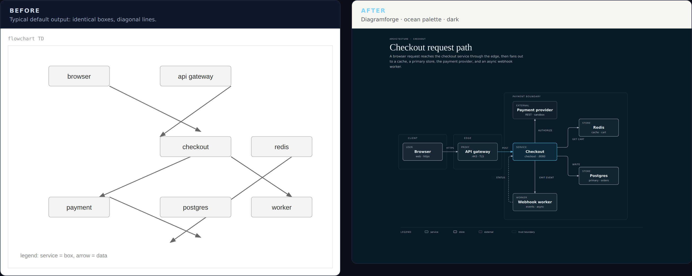

## What it does

- Chooses the diagram by the question, not by a type name, then loads that type's layout
  grammar and budget.
- Writes one offline `.html` with inline CSS and inline SVG. No Google Fonts, CDN, script,
  or build step for the output.
- Ships nine palettes. Change one attribute to switch; the drawing does not move.
- Follows the operating system with `data-theme="auto"`, and can be forced light or dark.
- Adds motion only when asked: `draw`, `reveal`, `flow`, `focus`, or `combo`, all in pure
  CSS/SVG. Reduced motion, print, and static export show the final frame.
- Enforces orthogonal connectors, masked labels, one accent (twice at most), a 4px grid,
  4.5:1 text contrast, and an accessible SVG contract.
- Exports SVG and PNG from the HTML when requested, with the theme and static frame
  forced.

## Motion, in six seconds

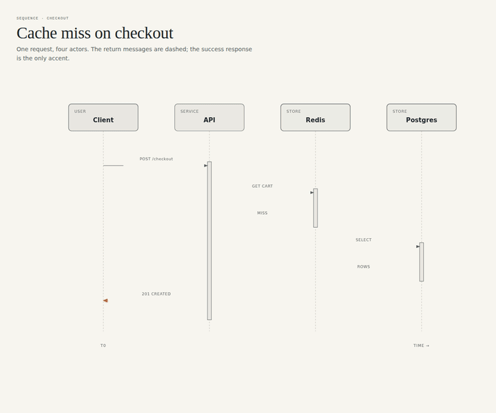

The three panels are `draw`, `reveal`, and `flow`. They are the same static files with
`data-animate` set on the SVG; remove it, print, or emulate reduced motion and the
complete figure remains. No JavaScript is involved.

## The one-line theme

The generated file is skinnable at runtime:

```html
<html lang="en" data-theme="auto" data-palette="ocean">
```

```html
<html lang="en" data-theme="dark" data-palette="brand"
      style="--brand-paper:#FFFFFF;--brand-ink:#141413;--brand-accent:#0B5FFF">
```

`data-theme` accepts `auto`, `light`, or `dark`. `data-palette` accepts `paper`,
`midnight`, `ocean`, `forest`, `sand`, `slate`, `mono`, `contrast`, or `brand`.

| Same geometry, light | Same geometry, dark |
|---|---|
| 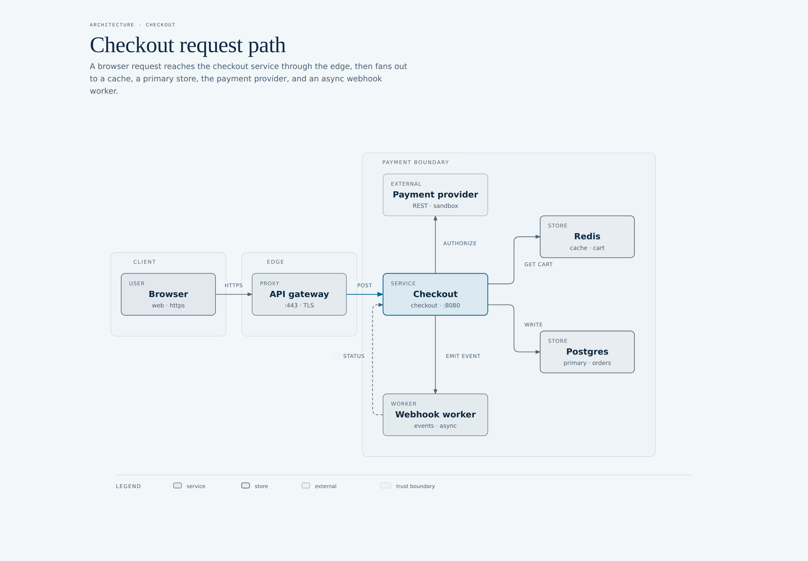 | 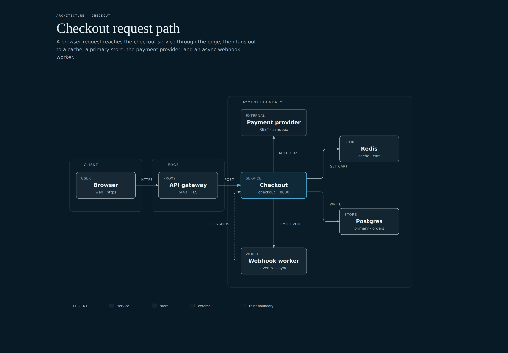 |

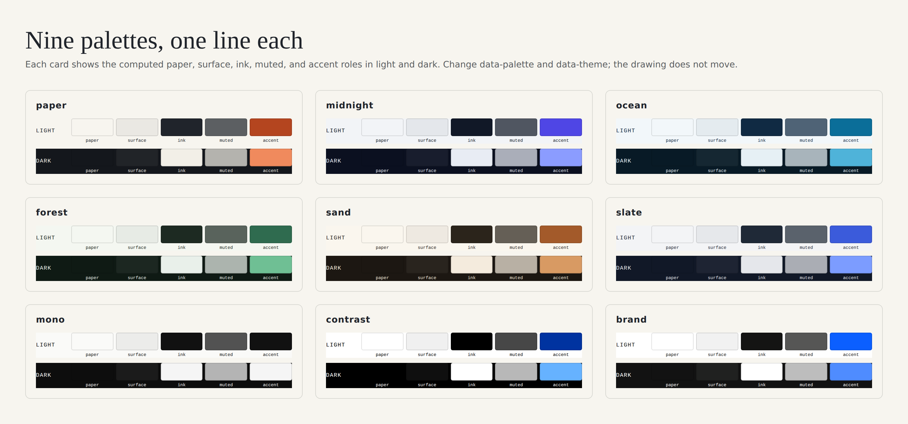

## Sixteen diagrams, two palettes, light and dark

Every diagram below is a standalone file. Each was built once from `examples/src/`, then
rendered with two palettes; the light and dark captures set only `data-theme`. All 64
PNGs are in [`assets/readme/examples/`](assets/readme/examples/).

| Diagram | Type | Motion | Palette A | Palette B |
|---|---|---|---|---|
| [Checkout architecture](examples/architecture-ocean.html) | architecture | none | [ocean light](assets/readme/examples/architecture-ocean-light.png) · [dark](assets/readme/examples/architecture-ocean-dark.png) | [sand light](assets/readme/examples/architecture-sand-light.png) · [dark](assets/readme/examples/architecture-sand-dark.png) |
| [Cache miss sequence](examples/sequence-paper.html) | sequence | draw | [paper light](assets/readme/examples/sequence-paper-light.png) · [dark](assets/readme/examples/sequence-paper-dark.png) | [midnight light](assets/readme/examples/sequence-midnight-light.png) · [dark](assets/readme/examples/sequence-midnight-dark.png) |
| [Event data flow](examples/data-flow-ocean.html) | data flow | reveal | [ocean light](assets/readme/examples/data-flow-ocean-light.png) · [dark](assets/readme/examples/data-flow-ocean-dark.png) | [slate light](assets/readme/examples/data-flow-slate-light.png) · [dark](assets/readme/examples/data-flow-slate-dark.png) |
| [Subscription state machine](examples/state-machine-slate.html) | state machine | draw | [slate light](assets/readme/examples/state-machine-slate-light.png) · [dark](assets/readme/examples/state-machine-slate-dark.png) | [sand light](assets/readme/examples/state-machine-sand-light.png) · [dark](assets/readme/examples/state-machine-sand-dark.png) |
| [Product organisation](examples/org-chart-forest.html) | org chart | reveal | [forest light](assets/readme/examples/org-chart-forest-light.png) · [dark](assets/readme/examples/org-chart-forest-dark.png) | [paper light](assets/readme/examples/org-chart-paper-light.png) · [dark](assets/readme/examples/org-chart-paper-dark.png) |
| [Incident timeline](examples/timeline-sand.html) | timeline | reveal | [sand light](assets/readme/examples/timeline-sand-light.png) · [dark](assets/readme/examples/timeline-sand-dark.png) | [ocean light](assets/readme/examples/timeline-ocean-light.png) · [dark](assets/readme/examples/timeline-ocean-dark.png) |
| [Monolith to services](examples/comparison-mono.html) | before/after delta | reveal | [mono light](assets/readme/examples/comparison-mono-light.png) · [dark](assets/readme/examples/comparison-mono-dark.png) | [ocean light](assets/readme/examples/comparison-ocean-light.png) · [dark](assets/readme/examples/comparison-ocean-dark.png) |
| [Trial-to-paid funnel](examples/funnel-paper.html) | funnel | reveal | [paper light](assets/readme/examples/funnel-paper-light.png) · [dark](assets/readme/examples/funnel-paper-dark.png) | [ocean light](assets/readme/examples/funnel-ocean-light.png) · [dark](assets/readme/examples/funnel-ocean-dark.png) |
| [Growth flywheel](examples/cycle-forest.html) | loop | flow | [forest light](assets/readme/examples/cycle-forest-light.png) · [dark](assets/readme/examples/cycle-forest-dark.png) | [midnight light](assets/readme/examples/cycle-midnight-light.png) · [dark](assets/readme/examples/cycle-midnight-dark.png) |
| [CI/CD pipeline](examples/ci-pipeline-slate.html) | pipeline | flow | [slate light](assets/readme/examples/ci-pipeline-slate-light.png) · [dark](assets/readme/examples/ci-pipeline-slate-dark.png) | [paper light](assets/readme/examples/ci-pipeline-paper-light.png) · [dark](assets/readme/examples/ci-pipeline-paper-dark.png) |
| [Orders schema](examples/database-schema-brand.html) | database schema | none | [brand light](assets/readme/examples/database-schema-brand-light.png) · [dark](assets/readme/examples/database-schema-brand-dark.png) | [sand light](assets/readme/examples/database-schema-sand-light.png) · [dark](assets/readme/examples/database-schema-sand-dark.png) |
| [Public API surface](examples/api-map-ocean.html) | API map | draw | [ocean light](assets/readme/examples/api-map-ocean-light.png) · [dark](assets/readme/examples/api-map-ocean-dark.png) | [slate light](assets/readme/examples/api-map-slate-light.png) · [dark](assets/readme/examples/api-map-slate-dark.png) |
| [Authentication retry](examples/flowchart-midnight.html) | flowchart | focus | [midnight light](assets/readme/examples/flowchart-midnight-light.png) · [dark](assets/readme/examples/flowchart-midnight-dark.png) | [paper light](assets/readme/examples/flowchart-paper-light.png) · [dark](assets/readme/examples/flowchart-paper-dark.png) |
| [Product bets](examples/quadrant-slate.html) | quadrant | none | [slate light](assets/readme/examples/quadrant-slate-light.png) · [dark](assets/readme/examples/quadrant-slate-dark.png) | [ocean light](assets/readme/examples/quadrant-ocean-light.png) · [dark](assets/readme/examples/quadrant-ocean-dark.png) |
| [Quality-gated pipeline](examples/data-pipeline-midnight.html) | data pipeline | flow | [midnight light](assets/readme/examples/data-pipeline-midnight-light.png) · [dark](assets/readme/examples/data-pipeline-midnight-dark.png) | [forest light](assets/readme/examples/data-pipeline-forest-light.png) · [dark](assets/readme/examples/data-pipeline-forest-dark.png) |
| [Narrow request path](examples/architecture-mobile-forest.html) | architecture, 360px | none | [forest light](assets/readme/examples/architecture-mobile-forest-light.png) · [dark](assets/readme/examples/architecture-mobile-forest-dark.png) | [paper light](assets/readme/examples/architecture-mobile-paper-light.png) · [dark](assets/readme/examples/architecture-mobile-paper-dark.png) |

Twelve of the sixteen are animated. Open
[`sequence-paper.html`](examples/sequence-paper.html) to watch the messages draw,
[`cycle-forest.html`](examples/cycle-forest.html) to watch the flywheel circulate, and
[`funnel-paper.html`](examples/funnel-paper.html) to watch stages appear in order. Each
one is a complete static figure when motion is reduced or the file is printed.

## A closer look

| Light | Dark |
|---|---|
| 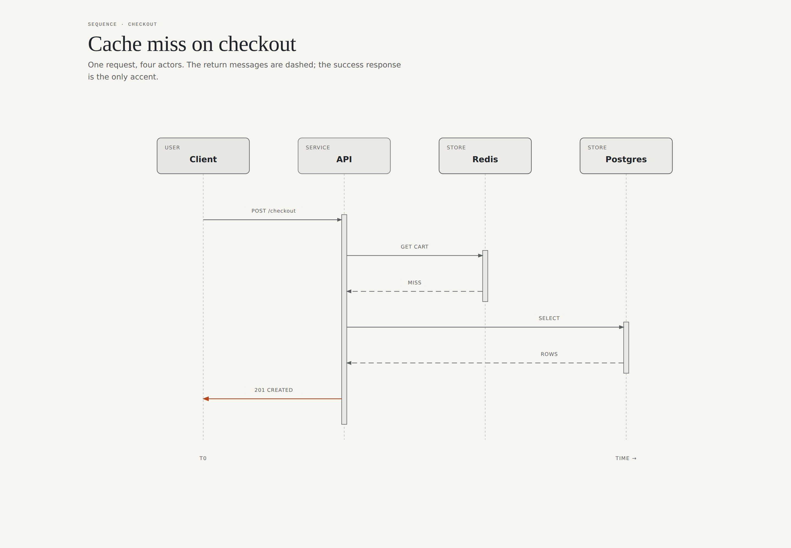 | 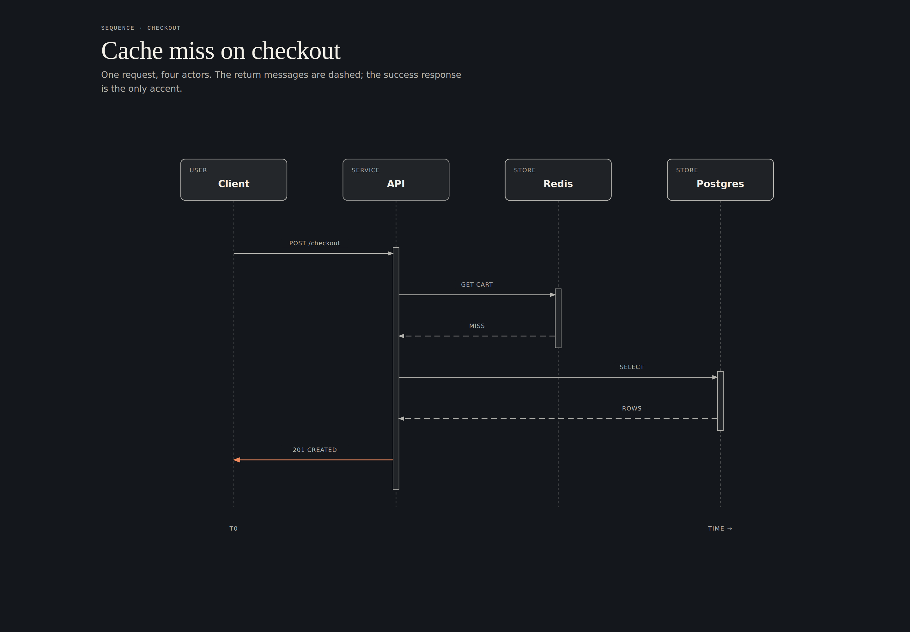 |
| 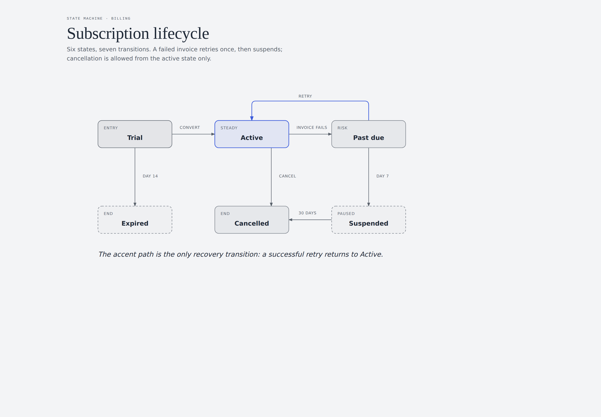 | 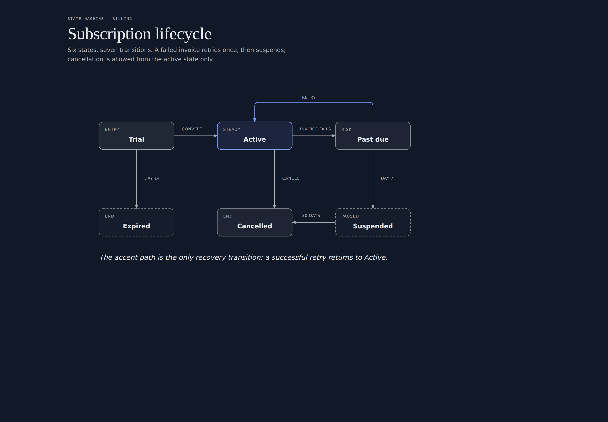 |
| 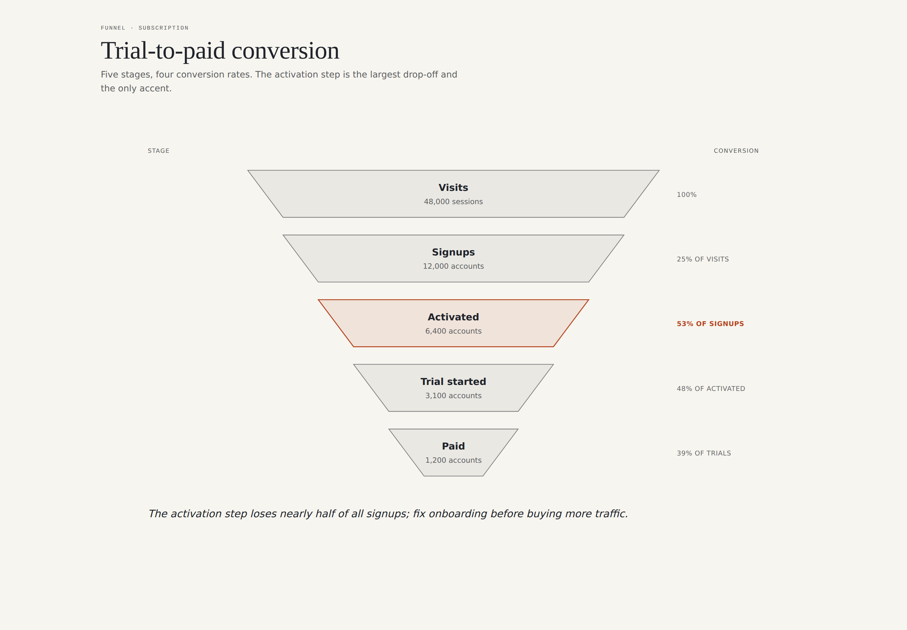 | 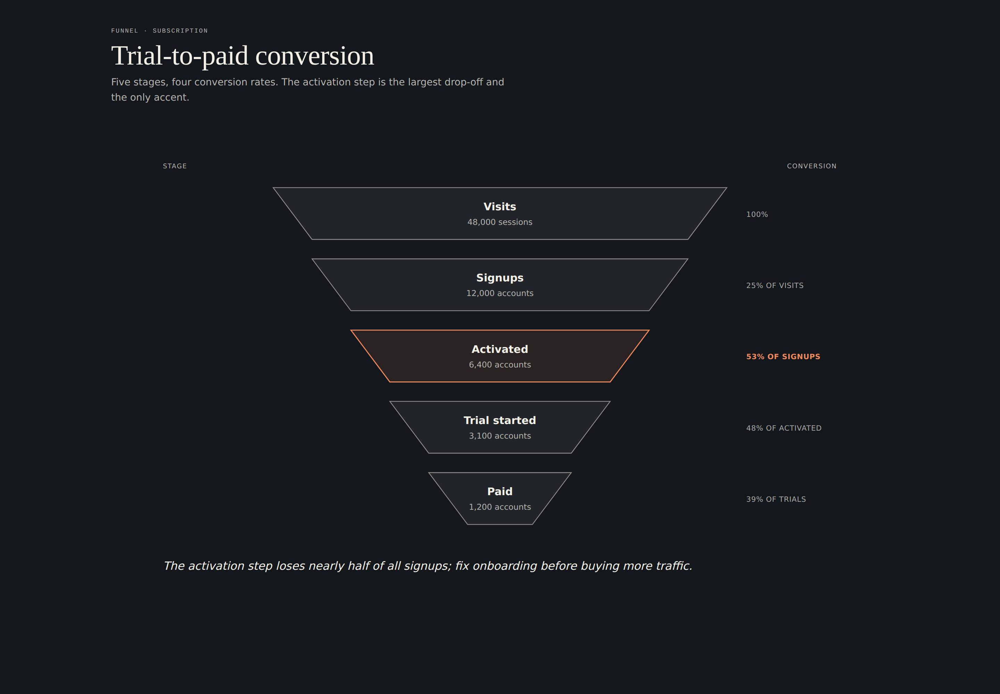 |
| 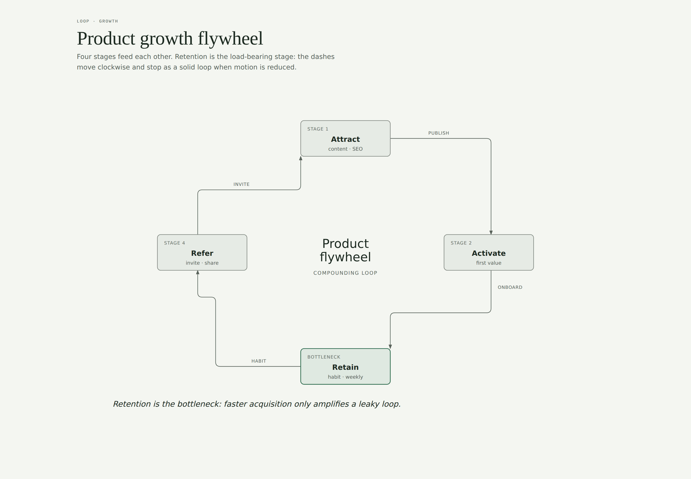 | 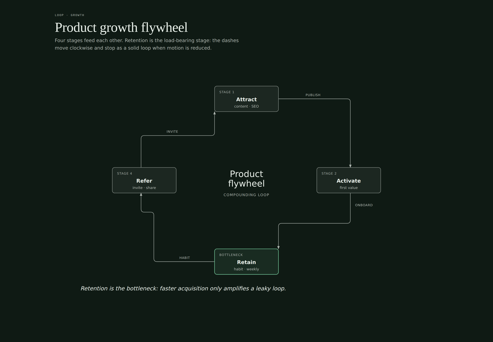 |
| 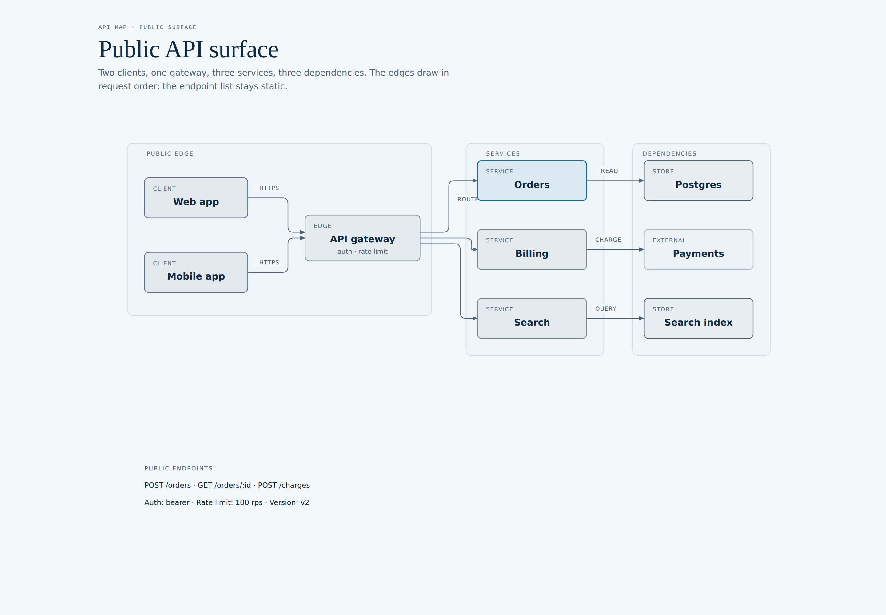 | 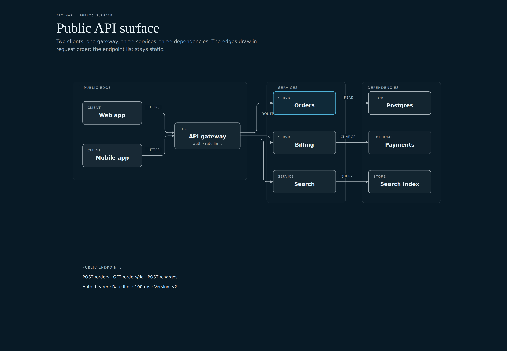 |

Mobile, 390px, with a 360-wide vertical layout that keeps the type ramp:

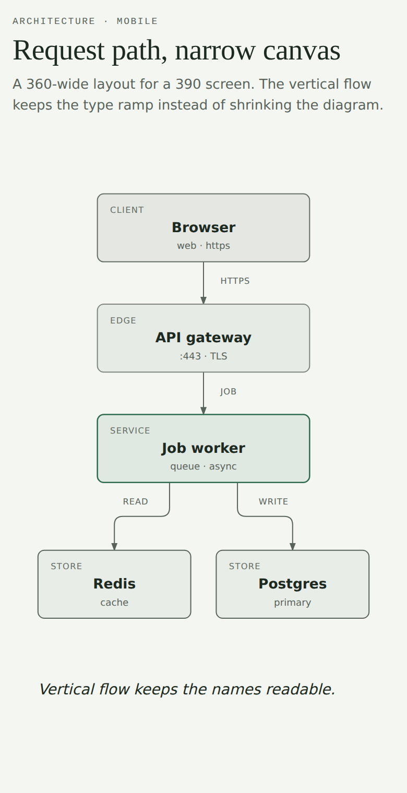

## Example prompts

> Draw the checkout architecture: browser, API gateway, checkout service, Redis,
> Postgres, the payment provider, and an async webhook worker. Ocean palette, dark, nine
> nodes maximum.

> Explain a cache miss as a sequence diagram. Animate the messages with a draw effect,
> then freeze the final frame for reduced motion.

> Show what changed between the v1 monolith and the v2 services, with a change ledger.

> Make an ERD for orders, payments, and customers. Use #0B5FFF as the accent, light mode,
> French labels.

> A six-event incident timeline. One focal event, no more than two annotations, export a
> static PNG.

## Animation modes

| Mode | Effect | Best for |
|---|---|---|
| `none` | complete static figure | default, print, screenshots, export |
| `draw` | strokes draw in `--order` | flows, sequences, dependencies |
| `reveal` | items appear in narrative order | stages, architecture, timeline |
| `flow` | dashes circulate on active edges | traffic, pipelines, loops |
| `focus` | one halo pulses on the focal node | a single decision or bottleneck |
| `combo` | `draw` + `reveal` | an ordered explanation with both |

Motion is decorative. The static source is complete, `prefers-reduced-motion: reduce`
shows the final frame, and `@media print` and `[data-static="true"]` freeze it.

## The forty types

| Family | Types |
|---|---|
| Systems | architecture, deployment, network topology, security boundaries, integration map |
| Flow and time | flowchart, sequence, state machine, timeline, swimlane, user journey, Gantt, roadmap, git graph, loop, service blueprint |
| Structure | ERD, database schema, UML class, tree, org chart, nested, layer stack, Venn, dependency graph |
| Data | data flow, data pipeline, capability map, requirement traceability |
| Analysis | quadrant, before/after delta, fishbone, pyramid/funnel, kanban |
| Quantitative | bar, line, radar, heatmap, treemap, waterfall |

The catalogue with choose-if text and budgets is in
[`references/index.md`](skills/diagramforge/references/index.md); the layout grammar for
each type is in [`references/diagram-types.md`](skills/diagramforge/references/diagram-types.md).

## Repository layout

```text
skills/diagramforge/
  SKILL.md              trigger, rules, workflow, final checklist
  references/           types, design system, palettes, layout, connectors,
                        animation, accessibility, export, choose
  assets/               template.html, themes.css, motion.css
examples/
  src/                  sixteen sources with one palette placeholder each
  <slug>-<palette>.html thirty-two standalone diagrams
  manifest.json         slugs, titles, motion mode, palette pairs
assets/readme/
  before-after.png      raw Mermaid output vs the traced architecture
  palettes.png          nine palettes in light and dark
  hero-light.png        the same architecture, light
  hero-dark.png         the same architecture, dark
  example-mobile.png    the 360-wide responsive layout
  examples/             sixty-four captures, two palettes × light/dark
assets/demo.gif         draw, reveal, and flow in one short loop
evals/evals.json        twelve prompt-level behaviour checks
scripts/                skill, contrast, geometry, motion, build, screenshot, GIF
```

The base the agent copies is
[`assets/template.html`](skills/diagramforge/assets/template.html). The theme sheet is
[`assets/themes.css`](skills/diagramforge/assets/themes.css); the motion sheet is
[`assets/motion.css`](skills/diagramforge/assets/motion.css). Examples are assembled from
`examples/src/` by `npm run lint:examples`, so the shared CSS cannot drift.

## Development

```bash
npm run lint            # structure, contrast, geometry, motion, provenance, example drift
npm run lint:browser    # every example in Chromium: light/dark, console, reduced motion
npm run lint:examples   # rebuild the 32 example files from src + shared sheets
npm run lint:shots      # Playwright captures; dev dependency only
npm run lint:demo       # Playwright frames + ffmpeg → assets/demo.gif
npm run lint:provenance # only with ref/; no identical file or copied prose
```

`npm run lint` needs Node 20 or later and no browser. The capture scripts need Playwright
and Chromium:

```bash
npm run lint:setup
npx playwright install chromium
```

`lint:shots` forces the explicit light or dark frame and `data-static="true"` before
capturing, which is why two runs produce identical pixels. `lint:demo` captures the live
animation at 10 fps, then hands the frames to ffmpeg; neither tool is used by a generated
diagram.

Read [`CONTRIBUTING.md`](CONTRIBUTING.md) before changing the design system, a type
budget, or an example. The study behind the project is in [`ETUDE.md`](ETUDE.md).

## Provenance

The approach was informed by studying public agent-diagram skills, chiefly
[`cathrynlavery/diagram-design`](https://github.com/cathrynlavery/diagram-design). The
study is cited for method and constraints only. No file, paragraph, palette, drawing, or
stylesheet from that repository is copied or vendored here; every example, sheet, and
sentence in this repository was written for the project. The working clone lives in
`ref/` and is ignored by git. Where the clone is present, `npm run lint:provenance`
checks that no file is byte-identical, no paragraph is copied, and no twelve-word prose
run is shared.

## License

MIT for this repository. See [`LICENSE`](LICENSE). The diagrams and palettes are written
from scratch; no upstream artwork or reference prose is vendored.
